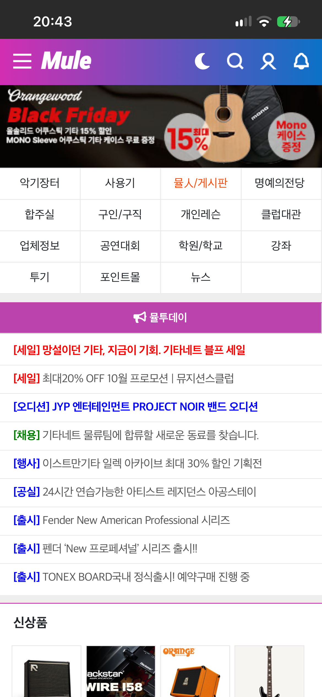
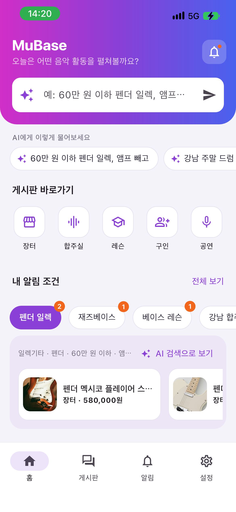
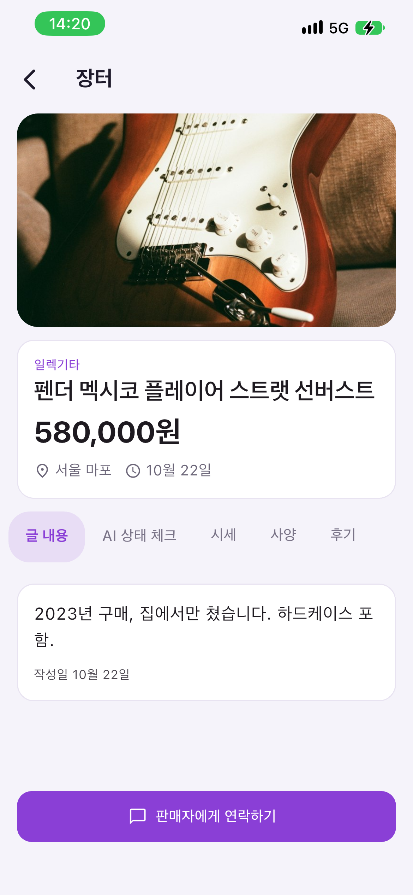
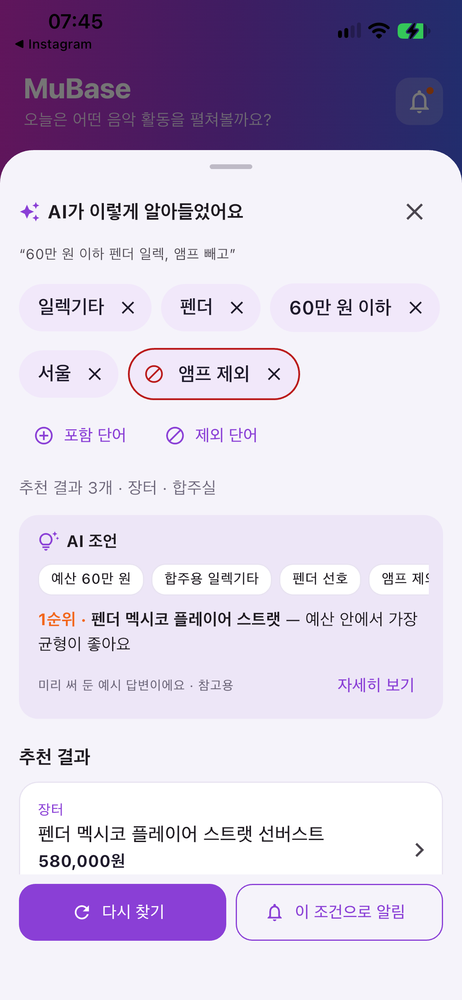
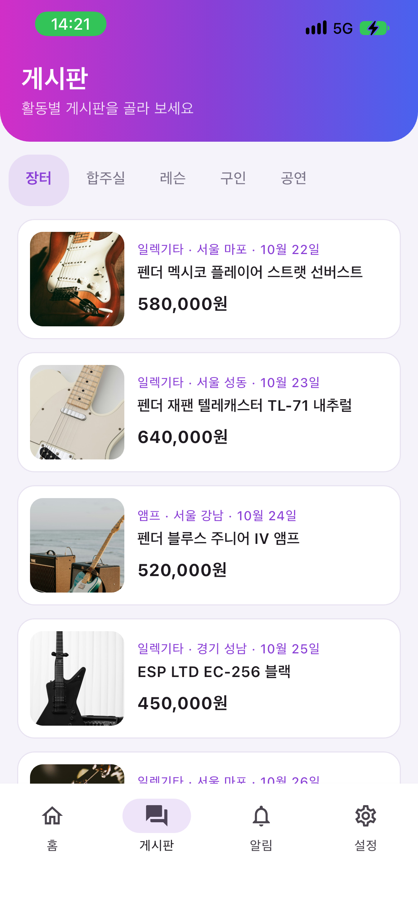

# MuBase v2 — GAI3008 중간프로젝트 저장소 (1인 1팀)

## 앱 소개

> 앱스토어 상품 페이지처럼 채웁니다. 칸 이름과 순서는 발표 자료의 "앱 소개" 장과 같습니다 — 바꾸지 않습니다.

### 앱 이름
MuBase

### 부제
뮤지션을 위한 AI 음악 커뮤니티 & 중고악기 장터

### 카테고리
음악

### 대상 사용자 / 사용 상황
- 대상 사용자: 취미로 음악을 즐기는 사람부터 전공자 · 전문가까지
- 사용 상황: 스마트폰 및 태블릿으로 악기 매물 · 합주실 · 레슨 · 구인 · 공연 정보를 찾고 고를 때

### 스크린샷
이미지는 `docs/screenshots/`에 넣고 아래 링크의 파일 이름만 맞춥니다. 3~5칸, 왼쪽부터 v1(현행) → v2.

| v1 현행 | v2 화면 A | v2 화면 B | v2 화면 C | v2 화면 D |
|---|---|---|---|---|
|  |  |  |  |  |
| 현행 홈 — 메뉴 15개 격자 | A 통합 홈 — 전반 기능과 AI 검색 기능 강조 | B 게시글 상세 — 사진 및 매물 상태 확인 | C AI 검색 확인 시트 — 알아들은 조건 · AI 조언 | D 게시판 — 활동별 탭 · 사진 카드 |

### 설명
1. **무엇을 하나** — 음악 활동에 필요한 정보를 얻고 서로 교류하는 것이 핵심이다. 그중 중고 악기 거래가 대표 기능이며, 합주실 · 연습실 · 레슨 · 멤버 구인구직 · 공연 소식까지 음악 활동에 필요한 정보를 함께 얻을 수 있다. 즉 정보 획득과 거래를 한곳에 모은 뮤지션 커뮤니티 플랫폼이다.
2. **v2가 푸는 문제** — 해당 앱을 사용하는 주 이유는 정보가 방대하다는 것이다. 따라서 이 방대한 정보를 사용자가 원하는 형태로 정보에 접근할 수 있어야 할 것이다. v2는 과거 v1에서의 정보 접근의 편의성 · 정확도 · 효율성을 한 단계 끌어올리는 것을 목표로 한다. 추가로 v2에서는 이러한 방대한 정보를 활용하여 단순 조회만 할 수 있는 것이 아닌 사용자에게 추가 가치를 제공할 수 있도록 한다.
3. **v2의 핵심 가치** — 원하는 조건을 대화하듯 말하면, AI가 조건을 분류하여 게시판 전체에서 맞는 정보를 제공하게 된다. 그 외로 컨설팅 기능과 같이 여러 조건에 대해 사용자와 함께 판단하여 최적의 선택을 할 수 있도록 도움을 제공할 수 있다.

### 새로운 기능
v2에서 바뀐 것 3개 — 원칙 카드(`docs/원칙카드.md`)의 P번호와 연결합니다.

| P번호 | 바뀐 것 (화면 · 요소 번호) | 근거 (리뷰 · 원칙) |
|---|---|---|
| P06 | **AI 대화형 조건 검색** — "60만 원 이하로 합주용 일렉 기타"처럼 목적 그대로 말하면, AI가 대 · 중분류와 키워드로 바꿔 장터 · 합주실 · 레슨 · 구인 · 공연 게시판 전체에서 찾아 준다. 어떤 분류와 키워드를 넣어야 할지 몰라도 된다. (A-2 AI 조건 입력창 → C-5 추천 결과 목록) | 현행 검색은 업데이트로 대 · 중분류 · 키워드 · 본문까지 찾을 수 있게 되었다. 하지만 이 도구는 "무엇을 넣어야 할지 아는 사람"을 전제로 한다. 중고거래가 처음인 사용자는 어떤 분류와 키워드를 골라야 할지부터 "어렵고 망설여진다"고 말한다(#7). 유형 ② · 저니 1 · 2단계 · P06 기억보다 재인 |
| P05 | **AI가 알아들은 조건 확인** — AI가 내 말을 어떤 분류 · 키워드 · 가격으로 바꿨는지 [일렉기타] [펜더] [60만 원 이하] [앰프 제외]처럼 결과보다 먼저 보여 준다. 틀린 조건은 X로 빼고 포함 · 제외 단어는 더하며, 같은 조건을 알림에도 그대로 쓸 수 있다. (C-2 AI가 알아들은 조건 영역 · C-3 제외 단어 추가 버튼 · C-7 알림 받기) | 현행 알림은 키워드 하나만 받고 제외 단어가 없다. 그래서 "펜더"를 걸면 앰프 · 베이스까지 오고(#1, 공감 64) "esp"는 "lespaul"에도 걸린다(#2). 검색에서는 고를 수 있는 대 · 중분류를 알림에서는 쓸 수 없어, 같은 조건을 두 곳에서 다르게 다뤄야 한다. 유형 ① · 저니 3단계 · P05 오류 예방 · P04 일관성 |
| P07 | **AI 판단 도우미 — v2의 핵심** — 예산에 맞춘 AI 조언(1순위와 이유 · 비교표 · 사기 전 확인할 것 · 예산을 바꾸면 · 근거), 사진 위 번호로 보는 AI 상태 체크, 평균 눈금과 한 줄 판단이 있는 시세 막대를 한곳에 모아 앱 밖을 오가지 않고 고를 수 있게 한다. 처음 사는 사람도 "이 매물이 내 예산에 적당한지"를 근거와 함께 판단한다. (C-4 AI 조언 카드 · B-6 AI 상태 체크 · B-5 시세 범위 막대) | 목록에 뜬 매물이 예산에 맞는지, 시세보다 싼지, 상태는 괜찮은지 앱은 알려 주지 않는다. 앱 하나로 해결된다는 장점(#16)과 달리 판단에 필요한 정보는 앱 밖에 흩어져 있어, 사용자는 비교 · 판단 단계에서 가장 크게 망설인다(#7). 유형 ② · ③ · 저니 4단계(감정 최저점) · P10 도움말 · P01 가시성 |

### 평가 및 리뷰
| 항목 | 내용 |
|---|---|
| 현행 별점 | ★ 3.9 (Google Play) / ★ 2.7 (App Store) |
| 리뷰 수 | 129개 (Google Play) / 91개 (App Store) |
| 대표 리뷰 | "뮬 알림기능 좋은데 카테고리화 해서 적용되면 좋겠네요.. 예를 들어 펜더 만 입력하면 기타. 앰프. 베이스 매물 등록될 때 알림이 다 뜨게 되는데 '기타'영역에 한정시킬 수 있으면 알림이 불필요하게 뜨는 것 줄일 수 있어요" — ★5 · 2019-07-09 · Google Play · 공감 64 (#1)<br>"키워드 본문내용으로는 검색 안되나요? 매물 놓쳤어요. ㅜㅜ" — ★1 · 2021-04-06 · Google Play (#5)<br>"악기 중고거래는 처음이라 어렵고 망설여져요, 초보자를 위한 쉬운 직관적인 디자인이 있으면 좋겠어요" — ★5 · 2026-03-30 · App Store (#7)<br>"아이폰 앱에서 뒤로가기 기능이 없습니다, 그것때문에 모바일 웹으로 사용하게 되네요.." — ★1 · 2026-10-06 · App Store (#8)<br>"정보도 많고 좋아요" — ★5 · 2020-04-24 · Google Play (#15)<br>(**작성자 이름 지움** · # 번호는 발표 자료 부록 B5-0 리뷰 번호 · 전체 17건은 B5-0) |
| 출처 | [Google Play](https://play.google.com/store/apps/details?id=com.mule.mulePortal) · [App Store](https://apps.apple.com/kr/app/mule-%EA%B3%B5%EC%8B%9D-%EC%95%B1/id1453003081) · 2026-10-25 확인 |

---

## 작성자 · 제출 정보

| 칸 | 내용 |
|---|---|
| 현행 앱 | 뮬(Mule) 공식 앱 — [Google Play](https://play.google.com/store/apps/details?id=com.mule.mulePortal) · [App Store](https://apps.apple.com/kr/app/mule-%EA%B3%B5%EC%8B%9D-%EC%95%B1/id1453003081) |
| v2 한 문장 | 원하는 조건을 대화하듯 말하면 AI가 게시판 전체에서 맞는 정보를 찾고, 예산 · 상태 · 시세로 함께 판단해 준다 |
| 작성자 | 이재열(응용정보공학전공) · 1인 1팀 |
| 데모 | 데모 영상 1분 · 원칙 클립 p01–p10: [Google Drive — midproj_video 폴더](https://drive.google.com/drive/folders/1oax1j1CO8nTbXLCElMQmVKgrBttjDIK4?usp=sharing) (GitHub는 100MB 제한이라 영상은 드라이브에 둠) |
| AI 사용 | 규칙 `AGENTS.md` · 기록 `docs/prompt-log.md` · 셀프 논증 기록 `docs/셀프논증.md` · 기획 확정 태그 `v1-plan` |

> 이 저장소는 **UI만 구현**합니다(중간고사 안내문 5장). 보이기는 다 동작하는 것처럼, 실제 동작(저장·로그인·결제·실제 계산)은 없습니다.
> 화면: 하단 메뉴(홈 · 게시판 · 알림 · 설정) + A 통합 홈 · B 게시글 상세 · C AI 검색 확인 시트 · D 게시판 · E 알림 · F 설정 — `docs/디자인가이드.md` 1장.

---

## 0. 처음 받았을 때: 폴더 이름 · 앱 이름 바꾸기

1. **폴더(저장소) 이름**: `mid-project-template` → `<영문 앱 이름>-v2` (예: `mealapp-v2`). GitHub 저장소 이름도 같게.
   - ⚠ **경로 전체를 영문·숫자·하이픈으로** 둡니다. 경로에 한글이 한 글자라도 있으면 `flutter analyze`(Flutter 3.44)가 analysis server 오류로 멈추는 것을 확인했습니다(`dart analyze`는 됨). 바탕화면·문서 폴더 이름이 한글이면 `C:\dev\` · `~/dev/` 같은 곳으로 옮깁니다.
2. **앱 이름(화면에 보이는 이름)** — 아래만 바꾸면 됩니다:
   - `lib/main.dart` — `MaterialApp(title: …)`, 각 화면 `AppBar` 제목
   - Android: `android/app/src/main/AndroidManifest.xml`의 `android:label`
   - iOS: `ios/Runner/Info.plist`의 `CFBundleDisplayName`
   - 웹: `web/index.html`의 `<title>`, `web/manifest.json`의 `name`·`short_name`
3. **패키지 이름 `mid_project_template`는 그대로 두는 것을 권장**합니다(바꾸면 `pubspec.yaml`의 `name`과 `test/`의 `import 'package:mid_project_template/…'`를 모두 고쳐야 함). 조직 ID는 `kr.ac.yonsei.gai3008`.

## 1. 실행 방법 — 터미널 2개

준비물: Flutter(Dart SDK ^3.10), Node.js 18 이상.

**터미널 1 — 목업 서버(json-server)**

```bash
cd mock_server
npm install && npm start             # http://localhost:3000  (npm run mock 도 같음)
curl http://localhost:3000/alerts    # 확인: JSON 배열이 나오면 성공
```

`db.json` 키: `posts` · `notices` · `alerts` · `aiResponses` · `priceInfo` · `usageReviews` · `conditionChecks` (앱은 GET만 씁니다).
이미 켜 둔 서버가 있으면 다시 켜지 않습니다(같은 3000번 포트를 쓰면 오류). `--watch`라서 `db.json`을 고치면 바로 반영됩니다.

**터미널 2 — 앱**

```bash
flutter pub get                   # 저장소 루트(pubspec.yaml 있는 곳)에서
flutter run -d macos              # 권장: 창 크기를 끌어 적응형(600 · 900dp)을 바로 볼 수 있다
flutter run -d chrome             # 웹으로 볼 때
```

| 실행 대상 | 앱이 부르는 주소 | 따로 할 일 |
|---|---|---|
| Chrome · macOS · Windows · iOS 시뮬레이터 | `http://localhost:3000` | 없음 |
| **Android 에뮬레이터** | **`http://10.0.2.2:3000`** | 없음 — `lib/api.dart`가 Android면 자동으로 10.0.2.2를 씀 |
| 실기기(같은 Wi-Fi) | PC IP | `flutter run --dart-define=API_BASE=http://192.168.0.10:3000` |
| Vercel 배포(가산) | 배포 주소 | `--dart-define=API_BASE=https://<프로젝트>.vercel.app/api` — `mock_server/README.md` 5장 |

- 서버가 꺼져 있으면 앱은 **오류 화면 + "다시 시도"**를 보여 줍니다(서버를 켜고 다시 시도 누르면 목록이 뜸).
- `flutter run` 때 터미널에 뜨는 `Error: Browsing on the local area network for …` 줄은 같은 Wi-Fi의 iPhone · iPad를 찾다 못 찾았다는 안내일 뿐이라 무시해도 됩니다.
- 실행 중 코드가 크게 바뀌었으면 `r`(핫 리로드) 대신 `R`(핫 리스타트)을 누릅니다.
- 서버 설정 · `db.json` 바꾸는 법 · CORS: `mock_server/README.md`.

### 직접 입력해 볼 문장 (미리 정한 임의 결과)

| 입력 (A-2 AI 조건 입력창) | 결과 |
|---|---|
| `60만 원 이하 펜더 일렉, 앰프 빼고` (그 밖의 아무 문장도 같음) | 결과 있음 — 응답 1: 조건 칩 · AI 조언 · 추천 결과 3개 |
| `강남 주말 드럼 합주실 1만 원 이하` (띄어쓰기는 달라도 됨) | 결과 없음 — 응답 2: 빈 상태 "조건을 하나 빼 보세요" |

문장을 해석하거나 추천을 계산하지 않습니다(안내문 4장 감점 항목). 홈의 예시 칩을 누르면 입력창이 채워집니다.

### 상태 화면 시연 — 로딩 · 오류 · 빈 상태 (발표 · 영상용)

**앱 안에서 바꾸기(권장)**: 하단 메뉴 **설정 → 발표 · 영상용(F-4)** 에서 `평소 · 느리게 · 오류 · 빈 결과`를 고릅니다. 다음 불러오기부터 적용됩니다(아래로 당겨 새로고침하거나 게시판 탭을 바꾸기). 저장하지 않으므로 앱을 다시 켜면 "평소"입니다.

**실행할 때 정하기**:

```bash
flutter run --dart-define=DEMO_STATE=loading   # 3초 로딩 (slow 도 같음)
flutter run --dart-define=DEMO_STATE=error     # 오류 + 다시 시도
flutter run --dart-define=DEMO_STATE=empty     # 빈 상태
```

`API_BASE`와 함께 써도 됩니다. 촬영 순서 · 장면별 시간은 [`docs/촬영계획.md`](docs/촬영계획.md).

## 2. 구조

```
mid-project-template/
├── README.md                 # 실행 방법 [필수]
├── AGENTS.md                 # AI 가드레일 (UI만) — CLAUDE.md는 이 파일을 따른다는 한 줄
├── pubspec.yaml              # 추가 패키지는 http 하나
├── lib/
│   ├── main.dart             # 앱 뼈대(S-1 · S-2) · 화면 흐름 주석
│   ├── theme.dart            # S-2 브랜드 색(뮬 그라데이션 · 주황 강조)
│   ├── api.dart              # GET만 · API_BASE · DEMO_STATE · AppLoaders
│   ├── models.dart           # JSON → 객체 (Dart 3 패턴 fromJson)
│   ├── widgets.dart          # LoadingView · ErrorView · EmptyView · GradientHeader · PillButton …
│   └── screens/
│       ├── main_shell.dart       # S-3 하단 메뉴(홈 · 게시판 · 알림 · 설정) — NavigationBar
│       ├── a_list_screen.dart    # 화면 A 통합 홈 — 내 알림 조건 · AI 조건 입력창 · GET /alerts · /notices
│       ├── b_detail_screen.dart  # 화면 B 게시글 상세 — push · 판단 정보 탭 5개 · B-8 불러오기 상태
│       ├── c_result_sheet.dart   # 화면 C AI 검색 확인 시트 — 모달 시트 · 미리 정한 응답 · AI 조언
│       ├── d_board_screen.dart   # 화면 D 게시판 — GET /posts?board= · 600 · 900dp 적응형
│       ├── e_alerts_screen.dart  # 화면 E 알림 — 알림 조건 카드 · GET /alerts
│       └── f_settings_screen.dart # 화면 F 설정 — 알림 스위치 · 데모 상태(F-4)
├── test/widget_test.dart     # 3상태 · push/tab/modal/NavigationBar · 600 · 900dp · 되돌리기 위젯 테스트
├── mock_server/
│   ├── db.json               # [필수] GET 데이터 (posts · notices · alerts · aiResponses · priceInfo · usageReviews · conditionChecks)
│   ├── package.json          # json-server 0.17.4 고정
│   ├── api/server.js · vercel.json   # (가산) 읽기 전용 배포
│   └── README.md
└── docs/
    ├── 디자인가이드.md       # 화면 목록 · 원칙 P01–P10 · 요소 분석 · 가이드 글 · 상태관리 포인트
    ├── 원칙카드.md           # P01–P10 카드 10장 (원칙 · 근거 · 적용 · 시연 · 판단)
    ├── 촬영계획.md           # 데모 1분 · 원칙 클립 촬영 순서와 입력 문장
    ├── prompt-log.md         # 4칸 (요청 · AI 결과 · 판단 · 이유)
    ├── 셀프논증.md           # 셀프 논증 기록: 내 주장 · 반론(AI) · 재반론 · 결론 · 근거 · 전/후
    ├── 자가평가.md           # 공개 배점 40/20/25/15 그대로
    ├── 영상/                 # demo_1min.mp4 · p01.mp4 …
    └── screenshots/          # README '앱 소개' 스크린샷 (01_v1_current.png …)
```

## 3. 화면 목록 ↔ 기획 문서 요소 번호

| 화면 | 이름 (비즈니스 명칭) | 파일 | 전환 | 요소 번호 |
|---|---|---|---|---|
| S | 앱 뼈대 · 하단 메뉴 | `lib/main.dart` · `lib/screens/main_shell.dart` | 앱 시작 · 옆으로(NavigationBar) | S-1 ~ S-3 |
| A | 통합 홈 | `lib/screens/a_list_screen.dart` | 첫 화면 · 하단 메뉴 '홈' | A-1 ~ A-3 · A-5 · A-8 ~ A-10 |
| B | 게시글 상세 | `lib/screens/b_detail_screen.dart` | 쌓기(push) · 옆으로(tab) | B-1 ~ B-8 |
| C | AI 검색 확인 시트 | `lib/screens/c_result_sheet.dart` | 덮기(modal) | C-1 ~ C-7 |
| D | 게시판 | `lib/screens/d_board_screen.dart` | 옆으로 — 하단 메뉴 '게시판' | D-1 ~ D-4 |
| E | 알림 | `lib/screens/e_alerts_screen.dart` | 옆으로 — 하단 메뉴 '알림' | E-1 ~ E-3 |
| F | 설정 | `lib/screens/f_settings_screen.dart` | 옆으로 — 하단 메뉴 '설정' | F-1 ~ F-4 |

각 화면 파일 맨 위에 **디자인 가이드 대응표**(번호 · Flutter 위젯명 · 비즈니스 명칭 · 원칙) 주석이 있고, 코드 안에서 같은 번호(`// D-4 P09`)로 찾을 수 있습니다. `docs/디자인가이드.md`와 1:1로 맞춥니다. **가이드에 없는 화면은 만들지 않습니다**(감점).

**상태관리 포인트**는 구현하지 않고 주석으로만 표시합니다: `// STATE: <데이터> → <보여질 위젯>` — 모아 보기 `grep -rn "STATE:" lib`

## 4. 원칙 번호 추적 P01–P10 [권장]

P번호 = 닐슨 원칙 번호. 원칙 카드에 붙인 번호 하나를 다섯 곳에 그대로 씁니다.

| 어디 | 쓰는 법 |
|---|---|
| 디자인 가이드 | `docs/디자인가이드.md` 2장 표 · 요소 분석의 원칙 칸 |
| 코드 주석 | 그 원칙을 보여 주는 위젯 줄 끝: `); // D-4 P09` |
| 커밋 메시지 | `p09: 게시판 목록 오류 화면에 다시 시도` |
| 영상 | `docs/영상/p09.mp4` (원칙별 5–10초) |
| 발표 | 원칙 카드 P09 — 시연 칸 = p09.mp4 |

찾기: `grep -rn "P09" lib/` · `git log --oneline --grep="p09"`

## 5. 기준점 Git 태그 `v1-plan` [권장]

내가 화면 기획(흐름 · 요소 분석 · 가이드 글)을 확정한 직후 **한 번만** 붙입니다. 그 뒤 커밋이 UI 진행 기록이 되고, 셀프 논증 기록의 전 · 후 기준이 됩니다.

```bash
git tag -a v1-plan -m "화면 기획 확정"
git push origin v1-plan
git log v1-plan..HEAD --oneline        # 그 뒤 무엇이 바뀌었나
git diff v1-plan..HEAD --stat
```

기획이 바뀌면 셀프 논증 기록에 쟁점으로 남기고, 태그는 지우지 않습니다.

## 6. 영상 파일 이름

- `docs/영상/demo_1min.mp4` — 전체 흐름 1분 [필수 — 제출물 ①, README "데모" 칸에 링크 · 배포 URL로 대신 가능]: 내 알림 조건 → 문장 입력 → C 시트 · AI 조언 컨설팅 → B 상세 탭 → 로딩 · 오류 · 빈 상태 → 넓은 화면
- `docs/영상/p06.mp4` · `p05.mp4` · `p07.mp4` · `p01.mp4` · `p10.mp4` · `p04.mp4`(필수) · `p03.mp4` · `p09.mp4` · `p02.mp4` · `p08.mp4`(권장) — 원칙별 5–10초 클립, 원칙 카드 번호와 같게. 장면은 `docs/촬영계획.md` 2장, 셀프 논증 '후' 캡처(i1~i5_after)는 3장
- 녹화 전: 개인정보 · 알림이 화면에 보이지 않는지 확인. GitHub는 100MB가 넘는 파일을 받지 않으니 큰 영상은 LMS·드라이브 링크로 README "데모" 칸에 적습니다.

## 7. 감점 점검 (제출 전, 결과가 비어 있어야 함)

```bash
grep -rnE "http\.(post|put|patch|delete)|SharedPreferences|sqflite|hive|FirebaseAuth|ChangeNotifierProvider|Riverpod|BlocProvider" lib/ pubspec.yaml
```

걸린 줄은 지웁니다(안내문 8장). 검색은 이름만 찾으므로 화면을 직접 눌러 보며 실제로 저장·전송되는 곳이 없는지도 확인합니다. 자세한 점검: `docs/자가평가.md`.

## 8. 제출 전 clone 테스트 [필수 확인]

내 컴퓨터에서만 되는 저장소를 막습니다. 다른 사람 입장에서 README 명령만으로 됩니까?

1. 새 폴더에 받기: `git clone <저장소 URL> clone-test`
2. 터미널 1: `cd clone-test/mock_server && npm install && npm start`
3. 서버 확인: `curl http://localhost:3000/alerts`
4. 터미널 2: `cd clone-test && flutter pub get`
5. 실행: `flutter run -d macos` 또는 `flutter run -d chrome` (Android 에뮬레이터는 그냥 `flutter run`)
6. 화면 전환 · GET 목록 · 로딩/오류/빈 상태(설정 F-4 또는 `DEMO_STATE`) · 넓은 화면(창 크기 늘리기) 확인 → 안 되면 README를 고치고 1부터 다시

자주 빠지는 것: `db.json`이 커밋되지 않음 · `node_modules/`까지 올림 · README의 폴더 이름이 실제와 다름.

## 9. 제출물 2종 체크 (LMS, 10/29(목) 15:00 전 — 9주차 수업 시작 전, 각자 제출)

발표는 10/29(목) 9주차 수업(7–9교시)입니다. 10/22(목)은 수업이 없습니다.

- [ ] ① **데모 시연 + 코드** — 이 템플릿을 바탕으로 고친 **GitHub 저장소 URL** — **clone 테스트 통과**
  - [ ] Flutter 코드 + `mock_server/db.json`
  - [ ] README — 앱 소개 8칸 · 실행 방법 · **데모 영상 1분 링크 또는 배포 URL**("데모" 칸)
  - [ ] `docs/` — 디자인 가이드 · 원칙 카드 · prompt-log · **셀프 논증 기록**(`docs/셀프논증.md`) · 자가평가
- [ ] ② **발표자료** — `mid-project-presentation-template` 사용(PPTX 또는 PDF, 6분 발표 + 2분 질의)
  - [ ] 본문 7장 + 부록 B1 데모·스크린샷 · B2 원칙 카드 · B3 prompt-log · B4 자가평가 · **B5 기획 상세**(사업 요약 · 저니 · 피쉬본/5 Why · 화면별 요소 분석표 · 상태관리 포인트)

기획 1–5단계는 발표자료(본문 + 부록 B5)에 담습니다. 기획 양식 PPTX는 **선택(참고용)**이며 제출물이 아닙니다.

## 10. 확인된 상태 (2026-10-28)

```bash
flutter analyze   # No issues found!
flutter test      # 18개 통과: 3상태(게시판 · 알림 조건 · 게시글 불러오기) · push/tab/modal/NavigationBar 흐름 · 600 · 900dp 격자 · 되돌리기 · 데모 상태
```

`pubspec.yaml` 의존성: `flutter`, `cupertino_icons`, `http`뿐. 플랫폼 설정: Android 디버그 빌드 평문 HTTP 허용(`android/app/src/debug/AndroidManifest.xml`), macOS 나가는 네트워크 허용(`macos/Runner/*.entitlements`).

## 11. 사진 출처

목업 게시글 사진(`mock_server/db.json`의 `image`)은 [Unsplash](https://unsplash.com)의 악기 · 합주 사진을 주소로만 불러옵니다(Unsplash License — 무료 사용). 사진을 불러오지 못하면 카테고리 자리표시 그림이 대신 나옵니다.
