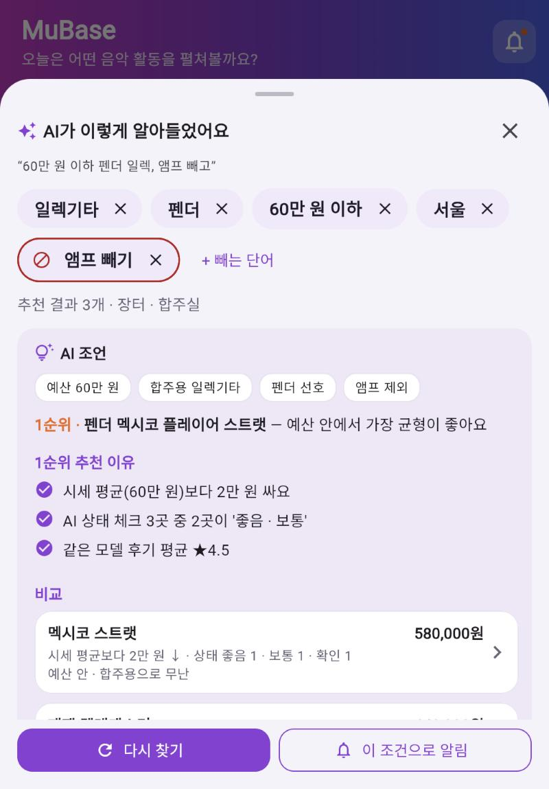

# 셀프 논증 기록 (제출물 ① 저장소 `docs/` · 20점)

> 1인 과제이므로 "협업" 대신 **스스로 논증**합니다. 내 설계 결정마다 **AI를 반론자로 세워** 약점을 공격받고, 다시 반박하거나 고쳐서 결론을 냅니다.
> 구조(쟁점마다): **내 주장 → 반론(AI · 나) → 재반론 · 수정 → 결론(유지 · 수정 · 폐기) → 근거(원칙 P번호 · 리뷰) → 전 · 후 화면**
> 이론: Toulmin 논증 모형(1958, *The Uses of Argument*) — 주장 · 근거 · 보증 · **반론**. 반론을 견딘 주장이 근거 있는 결정입니다.
> 증거: `docs/prompt-log.md`에서 AI에게 반론을 요청한 줄(날짜) · `docs/원칙카드.md`의 P번호. "AI가 그렇게 해서"는 근거가 아닙니다.
> 전·후 기준점: 기획 확정 때 붙인 Git 태그 `v1-plan` 시점 화면 = 전, 지금 화면 = 후 (`git diff v1-plan..HEAD --stat`).

작성자: LJY · 사용한 AI 도구: Claude(기획 · 리뷰 분석 · 문서), Claude Code(Flutter 구현)

## AI에게 반론을 요청한 문장

`v1-plan` 태그 시점의 화면 캡처를 함께 붙여 요청합니다. 요청과 답은 `docs/prompt-log.md`에 한 줄씩 남깁니다.

1. "MuBase v2의 화면 C(AI 검색 확인 시트)를 showModalBottomSheet로 띄우는 설계의 약점을 닐슨 원칙 번호로 3개 반박해 줘. 새 화면(Navigator.push)으로 만드는 쪽의 입장에서, 칭찬은 빼고."
2. "화면 C에서 'AI가 알아들은 조건'(C-2)을 추천 결과(C-5)보다 먼저, 가장 크게 보여 주는 결정에 반대하는 입장에서 논증해 줘. 사용자는 결과를 빨리 보고 싶어 한다는 관점으로, 닐슨 원칙 번호를 붙여서."
3. "AI 조언 카드(C-4)를 시트 안 조건 바로 아래에 두는 설계의 약점을 반박해 줘. 화면이 과밀해지는 문제(P08)와 사용자가 AI 조언을 그대로 믿게 되는 위험(P01 · P05) 관점에서."
4. (예비) "'이 조건으로 알림' 버튼(C-7)을 SnackBar만 띄우는 보조 버튼으로 둔 설계를 반박해 줘. 사용자가 등록한 알림을 확인하고 관리할 곳이 없다는 관점(P01 · P03)에서."

## 쟁점 목록

| # | 쟁점 (화면 · 요소 번호) | 내 주장 | 반론 (AI · 나) | 재반론 · 수정 | 결론 | 근거 (원칙 P번호 · 리뷰) | 전 · 후 화면 | 증거 (prompt-log · 원칙 카드) |
|---|---|---|---|---|---|---|---|---|
| 1 | AI 검색 결과를 시트(덮기)로 띄울까, 새 화면(쌓기)으로 띄울까 (화면 C 전체) | 홈 맥락을 유지한 채 조건만 확인하고, 시트를 내리면 바로 다시 말할 수 있어야 한다. 결과를 누르면 상세(B)로 쌓고, 뒤로 가면 시트로 돌아온다 | (v1-plan 후 기록) | | 유지 / 수정 / 폐기 | P03 사용자 통제 · 리뷰 #8 #9(뒤로가기) · 저니 2→3단계 | 전 `screenshots/i1_before.png` → 후 `screenshots/i1_after.png` | prompt-log 반론 요청 1 · 원칙 카드 P03 |
| 2 | AI가 알아들은 조건을 결과보다 먼저 · 가장 크게 보여 줄까 (C-2 · C-5) | 결과보다 조건을 먼저 보여야, AI가 잘못 알아들은 것을 결과를 보기 전에 고칠 수 있다 | (v1-plan 후 기록) | | 유지 / 수정 / 폐기 | P05 오류 예방 · 리뷰 #1(공감 64) #2 · 저니 3단계 | 전 `screenshots/i2_before.png` → 후 `screenshots/i2_after.png` | prompt-log 반론 요청 2 · 원칙 카드 P05 |
| 3 | AI 조언을 시트 안 조건 아래 카드로 둘까 (C-4) | 감정 최저점이 4단계 비교 · 판단이므로, 결과 바로 앞에 예산에 맞춘 조언 2–3문장을 접어서 보여 준다 | (v1-plan 후 기록) | | 유지 / 수정 / 폐기 | P10 도움말 · 리뷰 #7("어렵고 망설여져요") · 저니 4단계 | 전 `screenshots/i3_before.png` → 후 `screenshots/i3_after.png` | prompt-log 반론 요청 3 · 원칙 카드 P10 |
| 4 (예비) | 알림을 시트 맨 아래 보조 버튼 하나로 낮출까 (C-7) | 알림 정확도는 v2의 강조점이 아니다. 검색에 쓴 조건을 알림에도 그대로 쓰게 하는 버튼 하나면 충분하다 | (v1-plan 후 기록) | | 유지 / 수정 / 폐기 | P04 일관성 · 리뷰 #1 #2 · 근본 원인(검색과 알림의 규칙이 다름) | 전 `screenshots/i4_before.png` → 후 `screenshots/i4_after.png` | prompt-log 반론 요청 4 · 원칙 카드 P04 |

- **결론**: 유지(반론을 반박하고 그대로 감 — 반박 근거 필요) · 수정(반론을 받아 고침) · 폐기(주장을 버림 — 왜).
- 반론 없이 내 주장만 있으면 논증이 아닙니다. AI 반론을 그대로 받기만 하고 재반론이 없어도 약합니다.

## 전 · 후 화면 (쟁점별)

### 쟁점 1 — AI 검색 결과를 시트로 띄울까, 새 화면으로 띄울까

| 전 (v1-plan) | 후 |
|---|---|
|  |  |

- 관련 커밋: `p03: …` · 원칙 카드: P03 · prompt-log: __/__ 행

### 쟁점 2 — AI가 알아들은 조건을 결과보다 먼저 보여 줄까

| 전 (v1-plan) | 후 |
|---|---|
|  |  |

- 관련 커밋: `p05: …` · 원칙 카드: P05 · prompt-log: __/__ 행

### 쟁점 3 — AI 조언을 시트 안에 둘까

| 전 (v1-plan) | 후 |
|---|---|
|  |  |

- 관련 커밋: `p10: …` · 원칙 카드: P10 · prompt-log: __/__ 행
